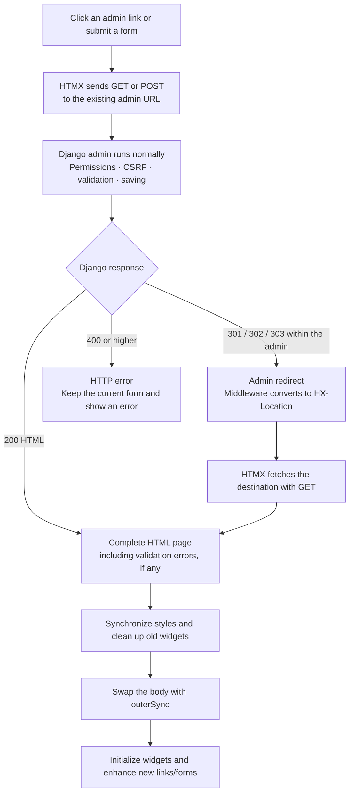

# Architecture and extension contract

Django remains the application. This package does not subclass, replace, or monkeypatch ModelAdmin or AdminSite. The template override extends Django's own `admin/base.html` and adds metadata, local scripts and a stylesheet scoped to loading feedback. The middleware only adapts requests resolved into an admin namespace whose rendered document contains that metadata. It does not trust HTMX headers as proof of authentication or authorization.

## How it works

HTMX lets the existing admin navigate and submit forms without a full browser
reload. Django still renders complete HTML documents and handles all application
logic. The browser selects the incoming `<body>`, swaps it with `outerSync`, and
initializes the new page's controls. The package does not require JSON endpoints
or separate fragment templates.

For example, searching a book list sends a GET to the same changelist URL Django
would ordinarily use. Submitting a valid add form sends a POST with its fields,
CSRF token, files and clicked save button. Django saves the object and issues its
usual redirect; the middleware turns that into `HX-Location`, so HTMX follows
with a GET instead of repeating the POST. Invalid forms return HTTP 200 with
Django's field errors and follow the normal HTML swap path.

Four files provide the integration:

- [The base template](../src/admin_htmx/templates/admin/base.html) extends
  Django's template and loads the local HTMX 4 runtime and adapter.
- [The browser adapter](../src/admin_htmx/static/admin_htmx/admin.js) adds
  `hx-boost="true"`, `hx-target="body"`, `hx-select="body"` and
  `hx-swap="outerSync"` to eligible links and forms. It also manages styles,
  widget cleanup, initialization, focus and request feedback.
- [Loading styles](../src/admin_htmx/static/admin_htmx/loading.css) target only
  the live status region while it has the `admin-htmx-loading` class. They add
  a fixed progress bar and status badge without restyling Django's controls.
- [The middleware](../src/admin_htmx/middleware.py) adapts responses for requests
  carrying both `HX-Request: true` and `X-Admin-HTMX: true`. It also prepares
  eligible HTML pages by converting recognized scripts into inert descriptors
  for the browser adapter to execute in order.

Widget lifecycle management is necessary because a body swap does not create a
new browser document or rerun its normal page-load events. The adapter removes
old listeners and widget state, loads foundational scripts once, reruns page
scripts, and initializes inlines, calendars, filtered selects, autocomplete and
action selection. This keeps Django's existing controls working across visits.

## Request lifecycle

1. Ordinary admin links and forms are rendered by Django. After successful initialization, eligible controls receive explicit HTMX 4 attributes. Same-origin URLs within the current AdminSite are enhanced. Modifier clicks, external links, widget anchors, popups, downloads and explicit opt-outs keep their native meanings.
2. HTMX collects real form controls and the clicked submit button; multipart forms retain file uploads and hidden CSRF tokens. One request at a time is admitted through `hx-sync="body:drop"`. The live status region announces loading immediately; after 200 ms it becomes a visible badge with an indeterminate top bar. The delay and visible state survive body swaps until requests and widget hydration finish. Fast completion or errors cancel the timer. Existing form submit buttons are temporarily disabled; no visual theme or extra navigation controls are added.
3. Django handles the request normally. Permission, validation, save hooks, messages and audit logging remain stock behavior. For this adapter's requests, 301/302/303 admin redirects become HTTP 200 with `HX-Location`; the next request is a GET. External/non-admin redirects use `HX-Redirect`. Cookies and security headers are retained. Other HTMX integrations' requests are not rewritten.
4. Full HTML documents are returned for both ordinary requests and enhanced requests. HTMX 4 selects and swaps the body with `outerSync`, including its class and data attributes. The incoming page's exact stylesheet set and cascade order replace the previous page's; stylesheet loading completes before widgets initialize. The document's language and direction are refreshed before the swap; Django's head media participate in the lifecycle too.
5. Stock script descriptors are inert until the loader runs them in dependency order. Foundational definitions are loaded once. Page scripts (sidebar, theme, filters, cancel, prepopulation and autofocus) run for each new page. Inlines, date/time, filtered selects, autocomplete and action selection are explicitly initialized. Temporary bridges handle jQuery ready/global expectations while a stock script loads; methods/globals are restored immediately afterward.
6. Before a swap, page-scoped global listeners, popups, Select2 state and jQuery element data are cleaned up. After hydration a public load event fires. Error lists or the main landmark receive focus. Body swaps reset scroll; browser history re-fetches authorized documents using HTMX 4's default server-backed restoration. No admin HTML history cache is placed in localStorage.

File responses are downloaded from the original response body, avoiding duplicate action execution. For failures and recovery, see [Error handling](#error-handling).

## Error handling

Validation and request failures take different paths. Django's normal invalid
forms are successful HTTP responses containing field errors. Transport failures
and HTTP error pages are intercepted so they do not replace an unsaved form.

| Situation | What happens | Recovery |
|---|---|---|
| Invalid form, inline or login credentials (HTTP 200) | Django renders its normal errors and bound form values. The body swaps normally; the first `.errorlist` receives focus when present. | Correct the values and submit again. File inputs must be reselected after a validation response, as in native Django. |
| HTTP 403, including permission or CSRF refusal | `htmx:before:response` cancels response processing and keeps the current form. The message says the request was refused and asks the user to check their session and permissions, then reload. | Resolve the session, permission or CSRF issue before submitting again. The adapter does not bypass Django's checks. |
| Other HTTP errors, such as 404, 422 or 500 | The same handler cancels response processing and keeps the current form. A generic message says the request could not be completed and the entries are still present. | Resolve the cause and retry manually when appropriate. Custom views returning 422 for field errors need their own HTMX integration or a native opt-out; their HTML is not swapped by this adapter. |
| Network failure or request timeout | The request's `htmx:error` event displays the generic error message. A failure before a swap leaves the current form in place. | Restore the connection and check whether the operation completed before retrying. |
| Session expiry resulting in a login redirect | The middleware converts the admin redirect to `HX-Location`; Django's login page is fetched and displayed with its normal `next` URL. | Log in again. Unsaved form values are not automatically restored or resubmitted. If Django rejects the request with 403 instead, the 403 path above applies. |
| Stylesheet/script loading or widget initialization failure caught during hydration | `hydrate()` logs the failure to the browser console and shows a message asking the user to reload before continuing. The new body may already have been swapped. | Reload after fixing the asset or initialization problem. The adapter does not roll the page back to its previous body. |
| A nonempty response lacks the enhancement marker | An enhanced GET falls back to full browser navigation. An enhanced POST instead shows a message asking the user to reload; it does not resubmit the POST. | Use a compatible template/script lifecycle or opt that flow out of HTMX. |

Request and initialization messages use Django's `errornote` class. The message
is placed in the content area, announced through an `aria-live="polite"` status
region and focused. The adapter also emits `admin-htmx:error` on `document` for
custom observability. Normal Django validation follows the regular page-load
lifecycle rather than emitting this adapter error event.

The request finalizer clears the request's busy state, and HTMX restores the
submit controls it disabled. `hx-sync="body:drop"` drops overlapping requests;
new adapter requests are also blocked while widgets are initializing. There is
no automatic POST retry or offline queue. Preserving a form does not prove that
a write failed on the server: a connection can fail after a save has committed.
Duplicate-submit prevention is not a server-side idempotency guarantee.

[Browser tests](../tests/test_browser.py) cover invalid forms and focus,
HTTP 500 draft retention followed by a successful manual save, delayed loading
feedback, fast completion/network-failure timer cancellation, slow stylesheet
hydration, duplicate-submit prevention, session expiry and native custom-media fallback.
[Backend tests](../tests/test_admin.py) cover validation, invalid inline rollback,
CSRF and permission enforcement. The request-timeout, focused 403 message,
asset-loading failure and unexpected POST response branches do not currently
have dedicated browser regression tests. See [coverage](COVERAGE.md) and
[recorded verification](VERIFICATION.md) for the broader test scope and results.

## Custom integrations

- Keep normal ModelAdmin classes, form classes, inlines, actions, template blocks and AdminSite URL registration.
- A custom template extending `admin/base_site.html` participates automatically if it uses stock scripts. A template replacing Django's base entirely keeps native behavior unless it includes the integration itself.
- Unknown scripts make that page use native Django navigation by default. This is deliberate: arbitrary scripts may depend on `DOMContentLoaded` or leak global event handlers. Following an enhanced GET into such a page completes with a full navigation. Its POSTs remain native.
- To opt custom media into the loader, add `data-admin-htmx-load="once"` or `data-admin-htmx-load="page"` on its script element. `once` should register persistent lifecycle callbacks; `page` must tolerate repeat execution (use an IIFE, not top-level lexical declarations).
- Listen on `document` for `admin-htmx:load` to initialize custom controls and `admin-htmx:before-swap` to destroy them. `admin-htmx:error` and `admin-htmx:download` are available for observability. A script loaded `once` during hydration receives that page's load event after it is registered.
- Add `data-admin-htmx="off"` to a control or wrapper, or `hx-boost="false"`, to keep its links/forms native. Use `ADMIN_HTMX_ENABLED = False` to disable enhancement globally.
- Existing `hx-get` / `hx-post` controls are left to their owner. This adapter should be the only HTMX core loaded on an enhanced admin page; do not add a second global HTMX build.

## CSP and response wrappers

The `csp_nonce` template context convention is supported on every Django series in the package's range. The two runtime scripts and dynamically loaded media use the active document nonce; a later HTMX response cannot replace that document's policy. A nonce-only script-src policy without unsafe-eval is covered by a real browser test. Other directives and third-party script requirements remain an integration concern.

Place the adapter after compression, conditional-response and cache-write middleware in MIDDLEWARE. Django processes responses in reverse order. Incorrect ordering is reported by system check admin_htmx.W003; compressed responses are never parsed as HTML. GZip transport is covered by an integration test.

## Supported boundaries

Stock related-object popups keep Django's opener/dismiss protocol and use ordinary full pages. Autocomplete uses Django's existing AJAX endpoint; its transport is Select2's own AJAX. These are intentional compatibility boundaries, not rewritten protocols. Basic HTML login and CRUD work without JavaScript; JavaScript-specific widgets have Django's usual non-JavaScript limitations. File inputs must be reselected after a validation response, as in native Django.

Custom script opt-ins are a developer contract, not an automatic guarantee. Verify rich text editors, unusual custom admin views, third-party themes, custom CSP policies and other browser engines in the integrating project. The package does not claim universal compatibility with arbitrary template replacements or media. See COVERAGE.md and VERIFICATION.md for measured coverage.

## Appearance contract

Colours, typography, geometry, responsive breakpoints, built-in navigation and widget appearance come directly from the installed Django version and project templates. The only package stylesheet targets the transient loading status: a thin top bar and bottom-corner badge use Django's color variables and respect reduced motion. They have no layout footprint and cannot intercept clicks. Fast requests and idle pages show no indicator; errors use stock Django classes. Visual tests compare an idle enhanced document with Django's unmodified base template for login, dashboard, app index, lists, forms, history, deletion, password change and returning to a list after form-specific CSS has been used. Django's stylesheet order, computed styles, geometry and screenshot comparisons remain intact; the scoped loading stylesheet is excluded only from the native stylesheet inventory comparison. Focus/hover are neutralized for these screenshot comparisons so interaction state does not mask styling differences.
