# Loading feedback

Unreleased change, verified on 2026-09-08.

Admin requests announce “Loading…” immediately. After 200 ms, a slim indeterminate top bar and a bottom-corner status badge become visible. They remain until navigation, save redirects and widget initialization finish. Fast requests cancel the timer. HTTP and network failures clear the indicator and leave Django-styled error feedback. Existing submit controls are disabled while saving; overlapping navigation and submissions are dropped.

The indicator uses Django’s colors, respects reduced motion, does not intercept clicks and does not change page layout. Idle screens retain Django’s default appearance. This feedback covers enhanced admin navigation and forms; native navigation and Select2’s own AJAX keep their existing behavior.

## Verification

- Full source suite: **71 passed** on Python 3.14.3 / Django 6.1.1 / Chromium 151.0.7922.34. [Actual run output](../evidence/loading-feedback/source-tests.txt).
- Browser regressions cover the 200 ms threshold, fast completion, network-failure timer cancellation, delayed stylesheet hydration, duplicate navigation/submission, POST/redirect/GET, retained drafts and manual recovery.
- Desktop light / mobile dark loading flows include animated and reduced-motion feedback. Four idle appearance scenarios still compare nine pages each against stock Django, using unchanged pixel, computed-style and geometry assertions.

- Built wheel and source distribution passed strict Twine and release-content checks. The wheel contains the scoped loading stylesheet.
- Fresh installed-wheel checks passed on Django **5.2.17, 6.0.8 and 6.1.1**, including collected static assets and real browser saves. [Results and wheel SHA-256](../evidence/loading-feedback/fresh-install.json); logs: [5.2](../evidence/loading-feedback/fresh-django52.txt), [6.0](../evidence/loading-feedback/fresh-django60.txt), [6.1](../evidence/loading-feedback/fresh-django61.txt).
- Ruff lint/format and ty checks passed. A separate browser check with simulated network latency confirmed visible pending feedback and an empty status after navigation completed.

The new results above are separate from the historical release matrix in [VERIFICATION.md](VERIFICATION.md). No package-index publication was performed.

## Ordered screenshots

Actual screenshots from the implemented UI with delayed requests. Select any image for its full-size original. [Open the compact gallery](../evidence/loading-feedback/index.html).

| Step | Desktop · 1440 px · light | Mobile · 390 px · dark / reduced motion |
|---|---|---|
| 1. Entry: dashboard | [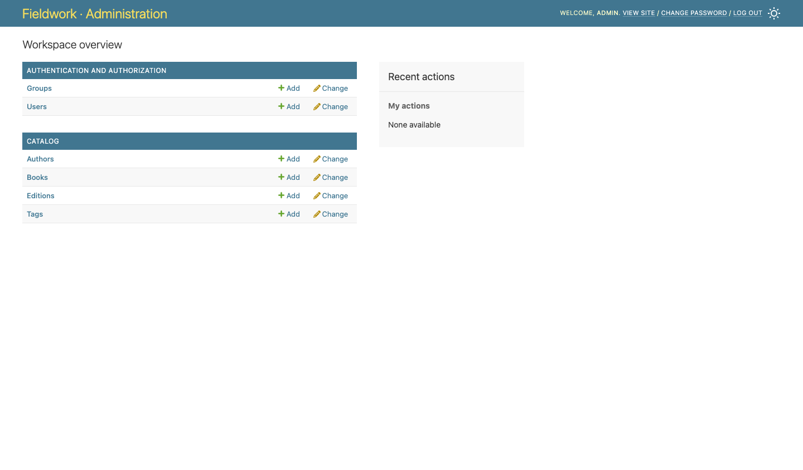](../evidence/loading-feedback/1440-01-entry.png) | [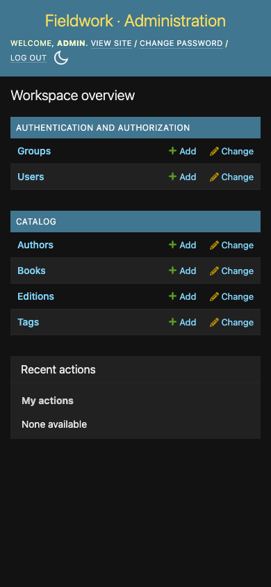](../evidence/loading-feedback/390-01-entry.png) |
| 2. Slow navigation: progress and loading status | [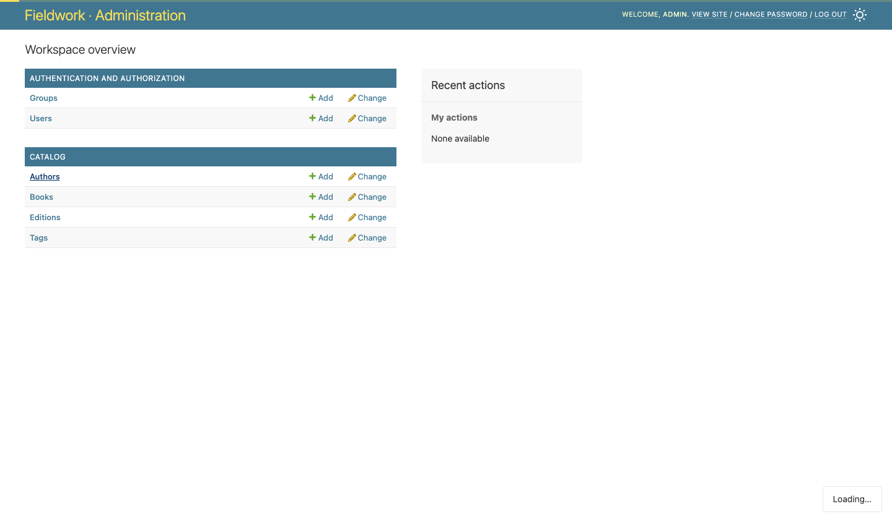](../evidence/loading-feedback/1440-02-navigation-loading.png) | [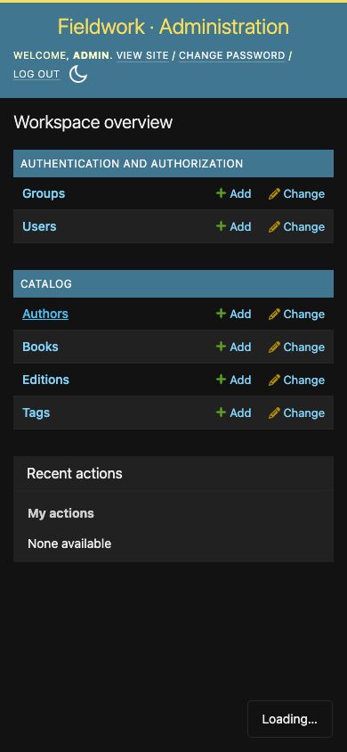](../evidence/loading-feedback/390-02-navigation-loading.png) |
| 3. Navigation complete: author list | [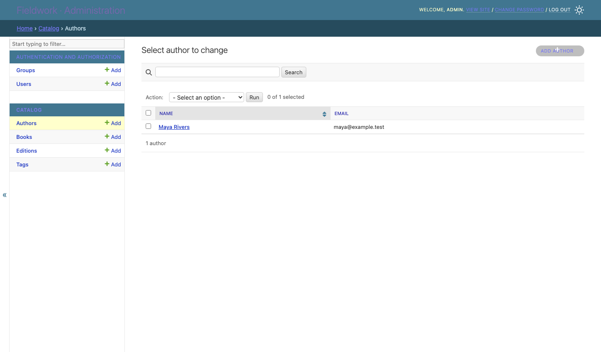](../evidence/loading-feedback/1440-03-navigation-complete.png) | [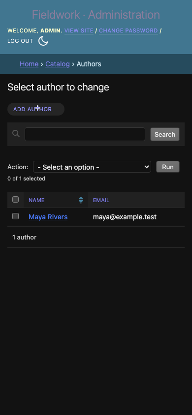](../evidence/loading-feedback/390-03-navigation-complete.png) |
| 4. Add author: completed form | [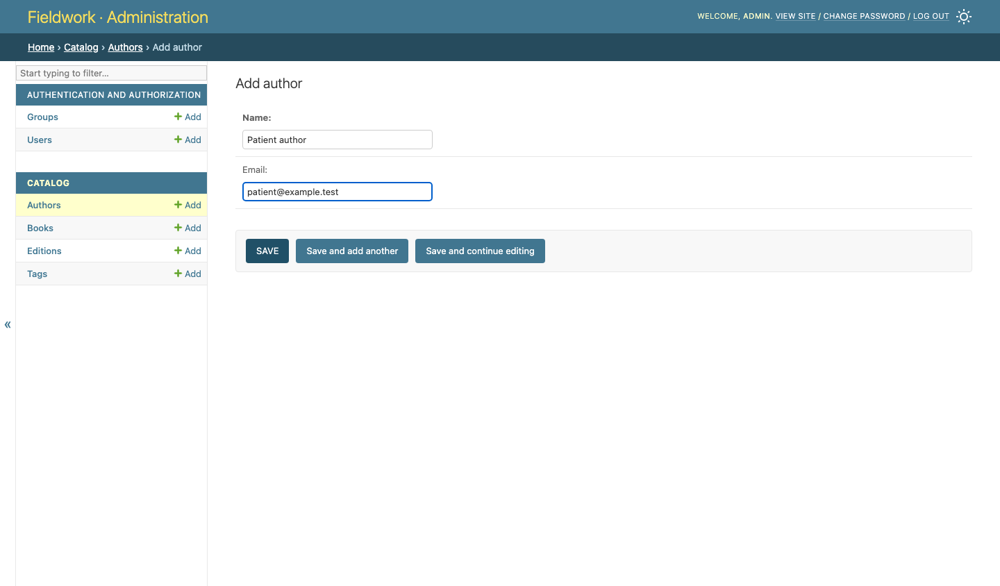](../evidence/loading-feedback/1440-04-form-ready.png) | [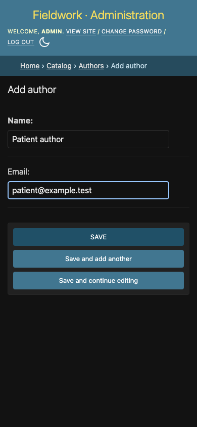](../evidence/loading-feedback/390-04-form-ready.png) |
| 5. Slow save: loading status and disabled submit controls | [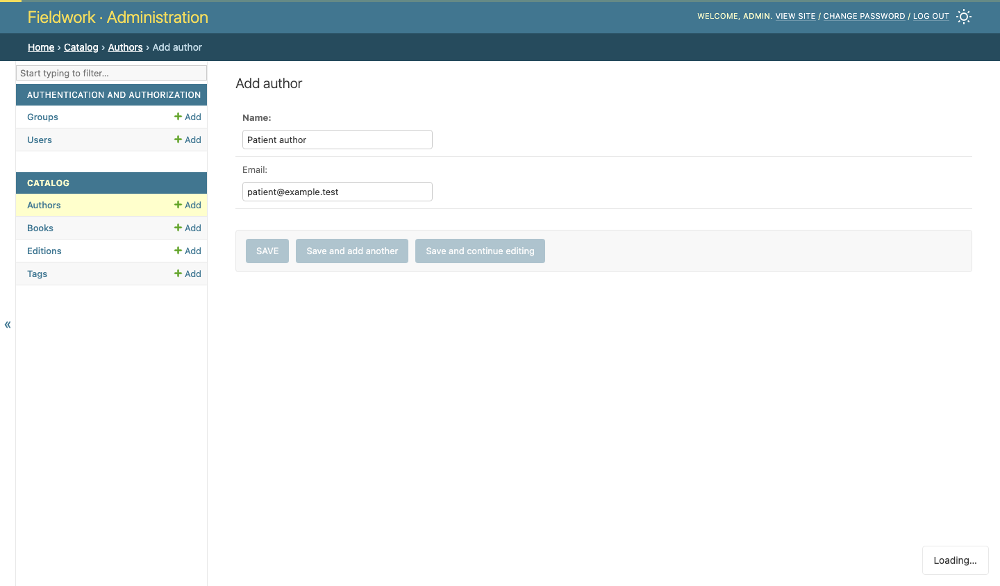](../evidence/loading-feedback/1440-05-save-loading.png) | [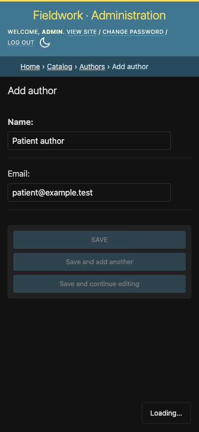](../evidence/loading-feedback/390-05-save-loading.png) |
| 6. Failed save: form retained and retry available | [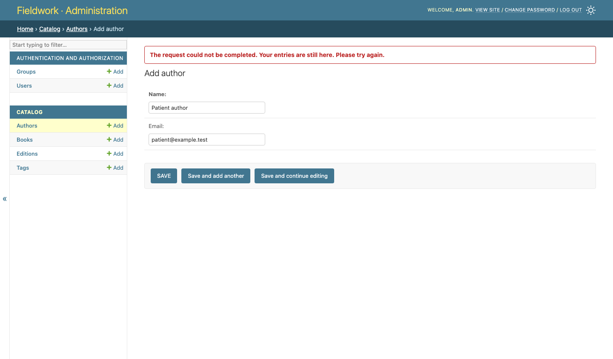](../evidence/loading-feedback/1440-06-error-retained.png) | [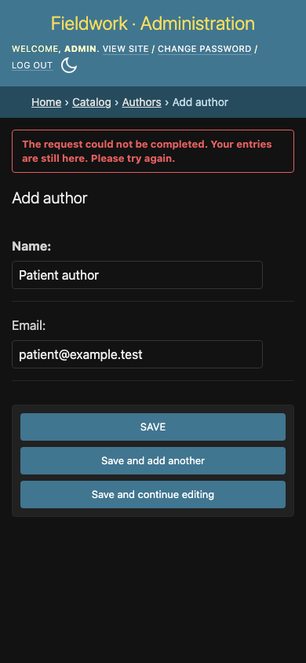](../evidence/loading-feedback/390-06-error-retained.png) |
| 7. Manual retry complete: saved author and success message | [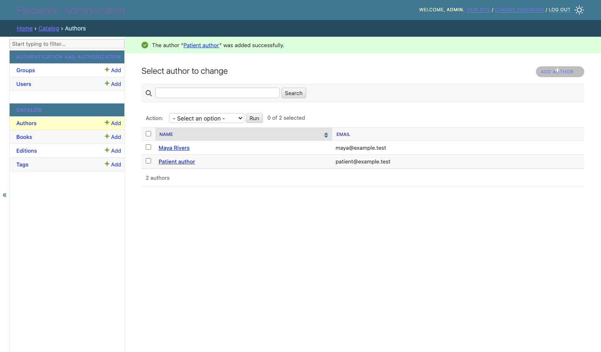](../evidence/loading-feedback/1440-07-saved.png) | [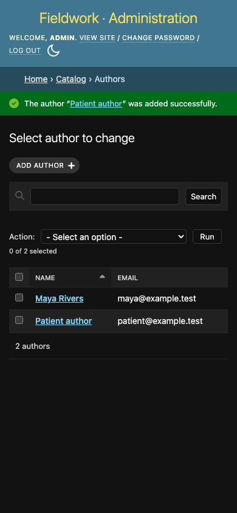](../evidence/loading-feedback/390-07-saved.png) |
