# Default Django appearance

Version 0.1.1 adds HTMX behavior without a theme stylesheet or extra navigation controls. The reference is Django's original admin/base.html, with this library disabled and absent from the reference page.

Each comparison checks stylesheet order, exact computed styles and element geometry, and screenshots. Focus/hover are neutralized for visual comparison. Up to 100 antialiased native-control corner pixels may differ by at most 8 out of 255 per colour channel; dimensions and computed styles of the visible controls must still match exactly. Actual HTMX request headers and a persistent window marker prove that the enhanced document is not reloaded.

| Django | Viewport | Theme | Result | Evidence |
|---|---|---|---|---|
| 5.2.17 | 1440 px | dark | 9 matched | [details](../evidence/style-parity/5.2.17/1440-dark.json) |
| 5.2.17 | 1440 px | light | 9 matched | [details](../evidence/style-parity/5.2.17/1440-light.json) |
| 5.2.17 | 390 px | dark | 9 matched | [details](../evidence/style-parity/5.2.17/390-dark.json) |
| 5.2.17 | 390 px | light | 9 matched | [details](../evidence/style-parity/5.2.17/390-light.json) |
| 6.0.8 | 1440 px | dark | 9 matched | [details](../evidence/style-parity/6.0.8/1440-dark.json) |
| 6.0.8 | 1440 px | light | 9 matched | [details](../evidence/style-parity/6.0.8/1440-light.json) |
| 6.0.8 | 390 px | dark | 9 matched | [details](../evidence/style-parity/6.0.8/390-dark.json) |
| 6.0.8 | 390 px | light | 9 matched | [details](../evidence/style-parity/6.0.8/390-light.json) |
| 6.1.1 | 1440 px | dark | 9 matched | [details](../evidence/style-parity/6.1.1/1440-dark.json) |
| 6.1.1 | 1440 px | light | 9 matched | [details](../evidence/style-parity/6.1.1/1440-light.json) |
| 6.1.1 | 390 px | dark | 9 matched | [details](../evidence/style-parity/6.1.1/390-dark.json) |
| 6.1.1 | 390 px | light | 9 matched | [details](../evidence/style-parity/6.1.1/390-light.json) |

The nine states are login, dashboard, app index, changelist, change form, history, deletion, password change and return to a list after visiting forms. The latter checks that form-specific CSS does not leak into another page.

## login · 1440px · light

| Default Django | With HTMX |
|---|---|
| [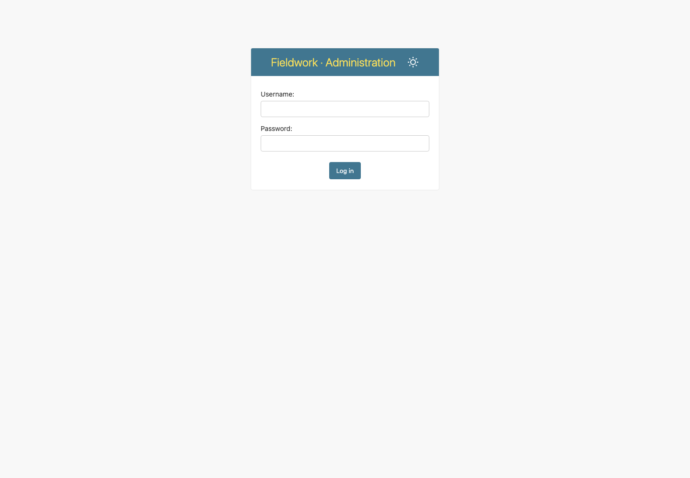](../evidence/style-parity/6.1.1/1440-light-login-native.png) |  |

## dashboard · 1440px · light

| Default Django | With HTMX |
|---|---|
| [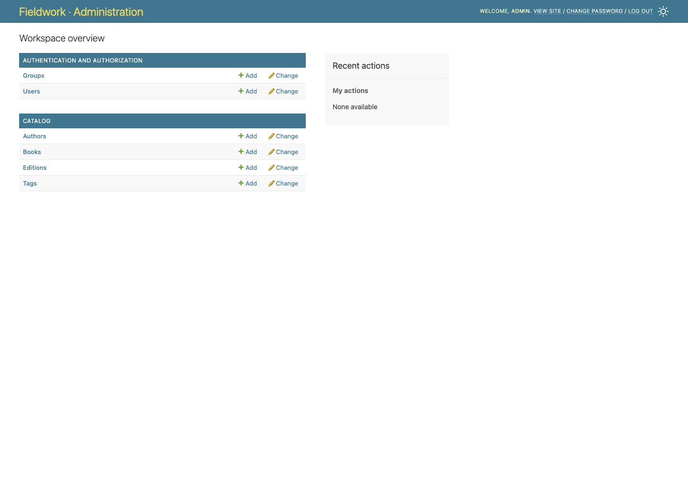](../evidence/style-parity/6.1.1/1440-light-dashboard-native.png) |  |

## changelist · 1440px · light

| Default Django | With HTMX |
|---|---|
| [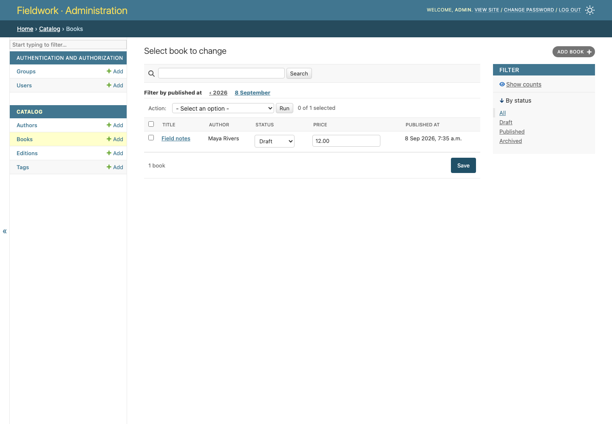](../evidence/style-parity/6.1.1/1440-light-changelist-native.png) |  |

## change-form · 1440px · light

| Default Django | With HTMX |
|---|---|
| [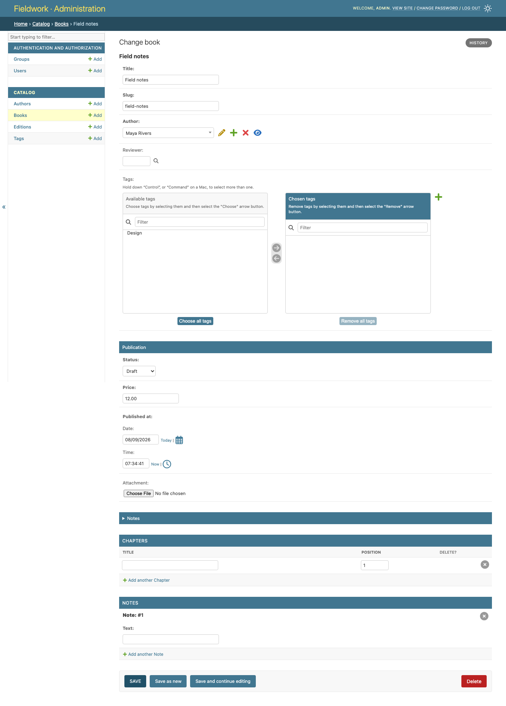](../evidence/style-parity/6.1.1/1440-light-change-form-native.png) |  |

## delete · 1440px · light

| Default Django | With HTMX |
|---|---|
|  | [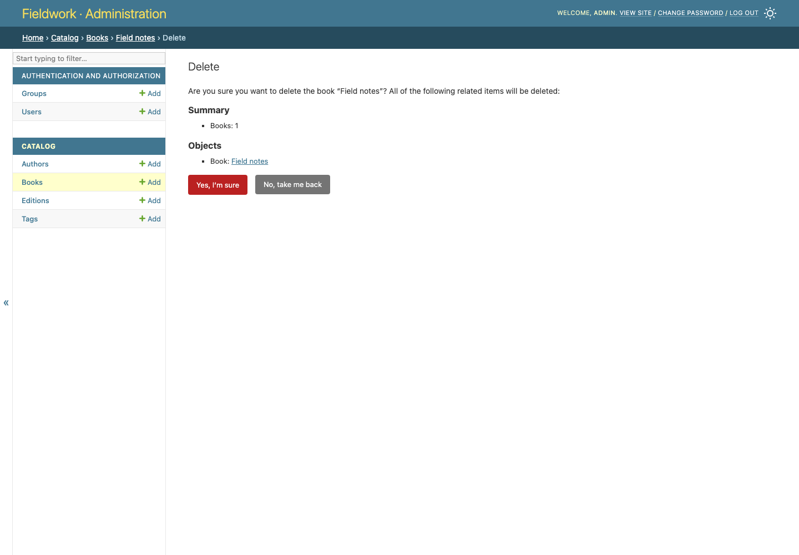](../evidence/style-parity/6.1.1/1440-light-delete-htmx.png) |

## login · 1440px · dark

| Default Django | With HTMX |
|---|---|
|  | [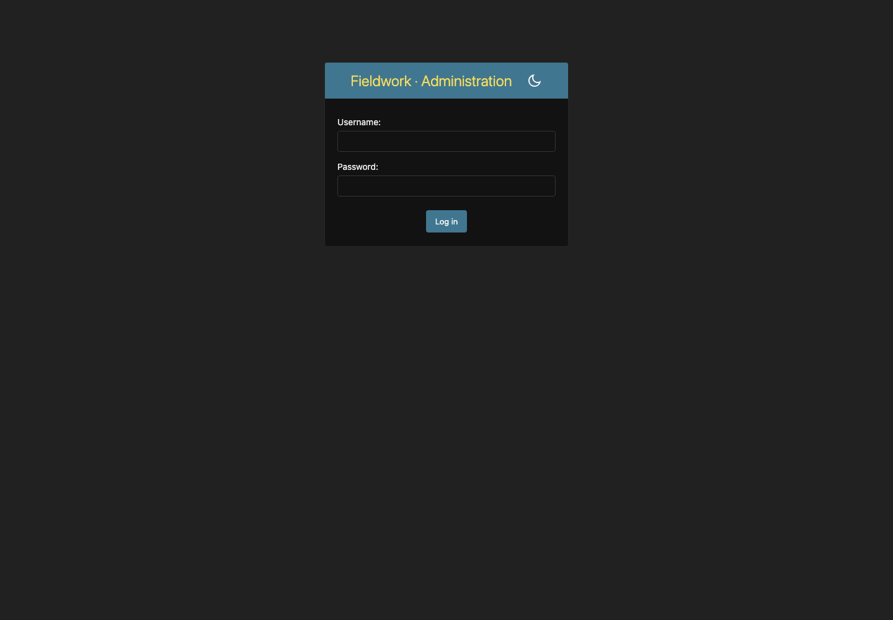](../evidence/style-parity/6.1.1/1440-dark-login-htmx.png) |

## dashboard · 1440px · dark

| Default Django | With HTMX |
|---|---|
|  | [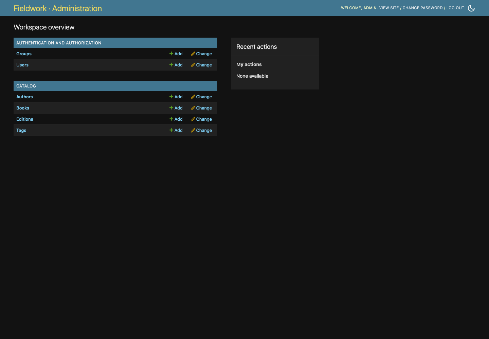](../evidence/style-parity/6.1.1/1440-dark-dashboard-htmx.png) |

## changelist · 1440px · dark

| Default Django | With HTMX |
|---|---|
|  | [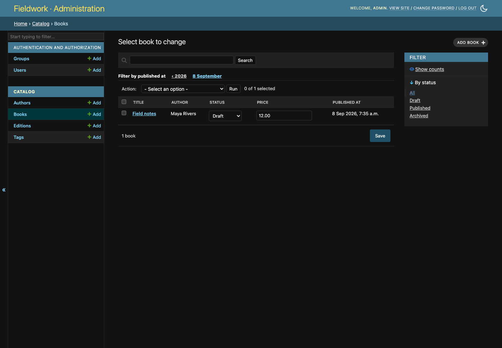](../evidence/style-parity/6.1.1/1440-dark-changelist-htmx.png) |

## change-form · 1440px · dark

| Default Django | With HTMX |
|---|---|
|  | [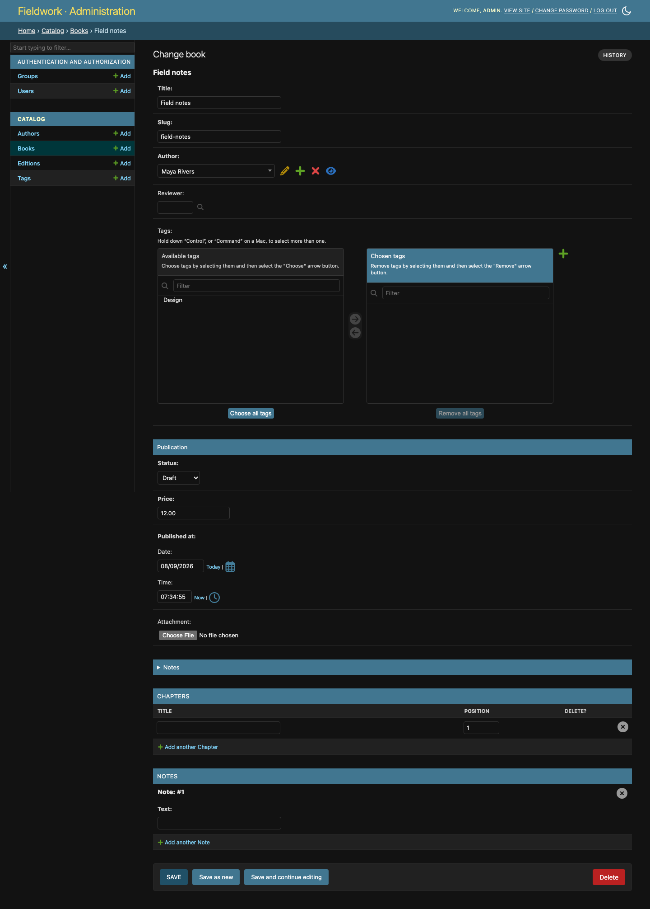](../evidence/style-parity/6.1.1/1440-dark-change-form-htmx.png) |

## delete · 1440px · dark

| Default Django | With HTMX |
|---|---|
|  | [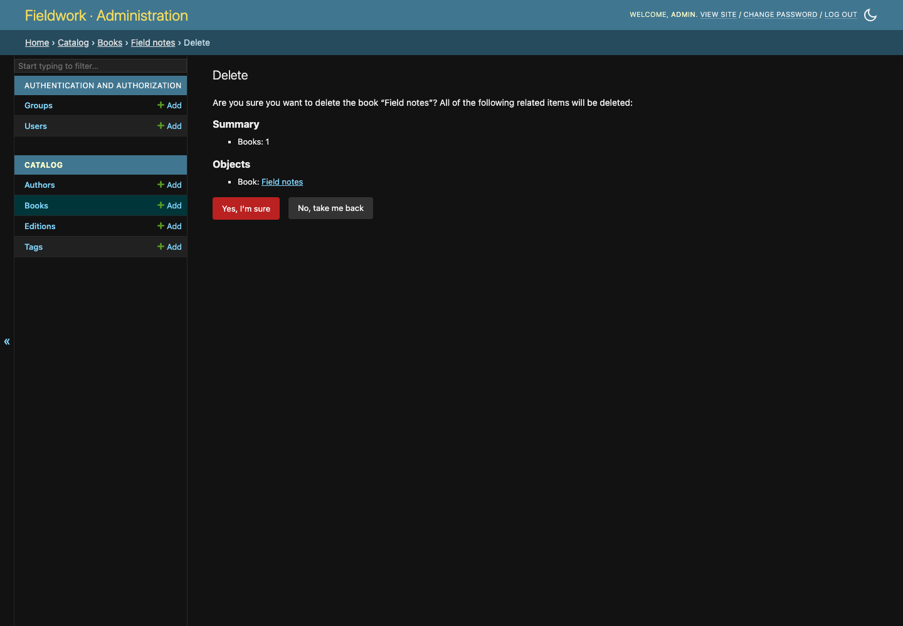](../evidence/style-parity/6.1.1/1440-dark-delete-htmx.png) |

## login · 390px · light

| Default Django | With HTMX |
|---|---|
| [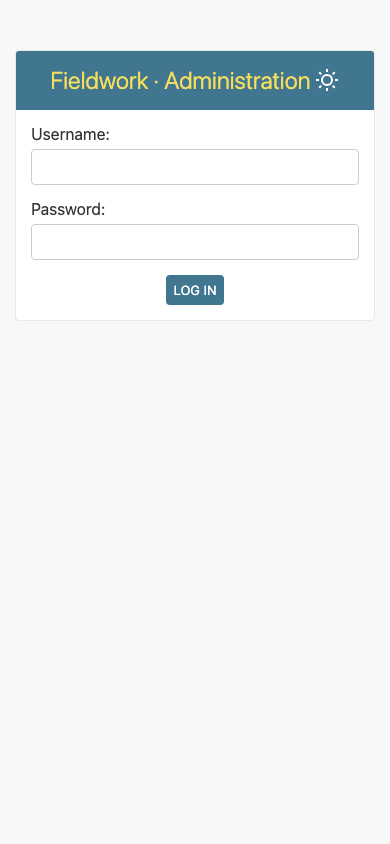](../evidence/style-parity/6.1.1/390-light-login-native.png) |  |

## dashboard · 390px · light

| Default Django | With HTMX |
|---|---|
| [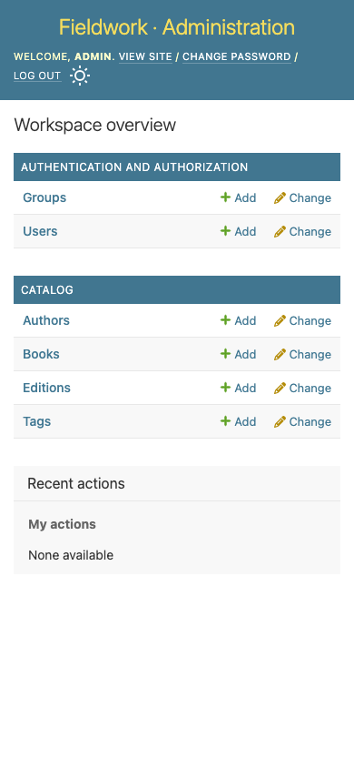](../evidence/style-parity/6.1.1/390-light-dashboard-native.png) |  |

## changelist · 390px · light

| Default Django | With HTMX |
|---|---|
| [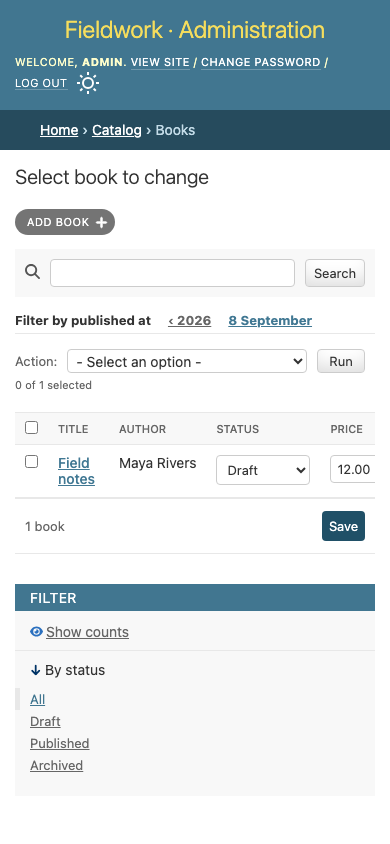](../evidence/style-parity/6.1.1/390-light-changelist-native.png) |  |

## change-form · 390px · light

| Default Django | With HTMX |
|---|---|
| [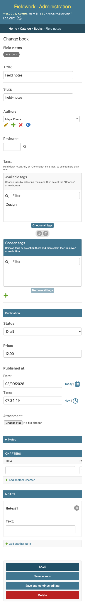](../evidence/style-parity/6.1.1/390-light-change-form-native.png) |  |

## delete · 390px · light

| Default Django | With HTMX |
|---|---|
| [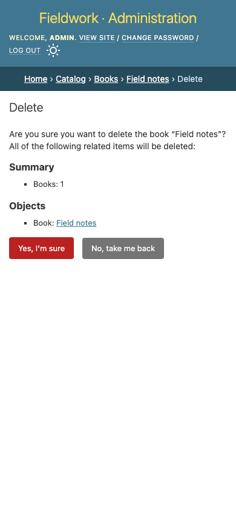](../evidence/style-parity/6.1.1/390-light-delete-native.png) |  |

## login · 390px · dark

| Default Django | With HTMX |
|---|---|
| [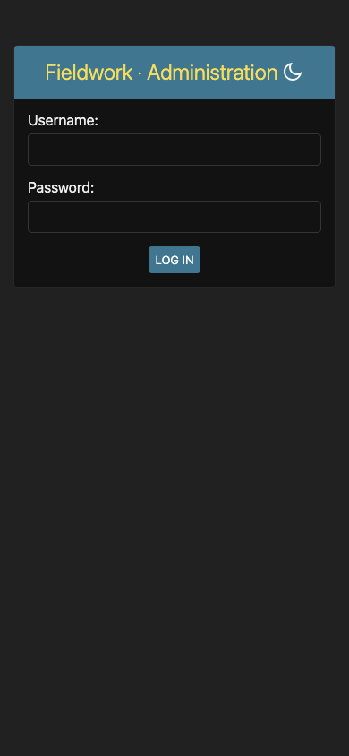](../evidence/style-parity/6.1.1/390-dark-login-native.png) |  |

## dashboard · 390px · dark

| Default Django | With HTMX |
|---|---|
|  |  |

## changelist · 390px · dark

| Default Django | With HTMX |
|---|---|
| [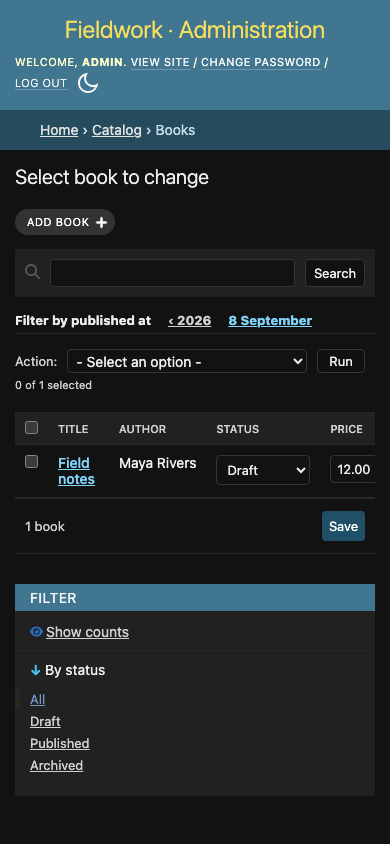](../evidence/style-parity/6.1.1/390-dark-changelist-native.png) |  |

## change-form · 390px · dark

| Default Django | With HTMX |
|---|---|
| [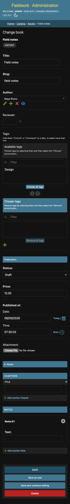](../evidence/style-parity/6.1.1/390-dark-change-form-native.png) |  |

## delete · 390px · dark

| Default Django | With HTMX |
|---|---|
|  | [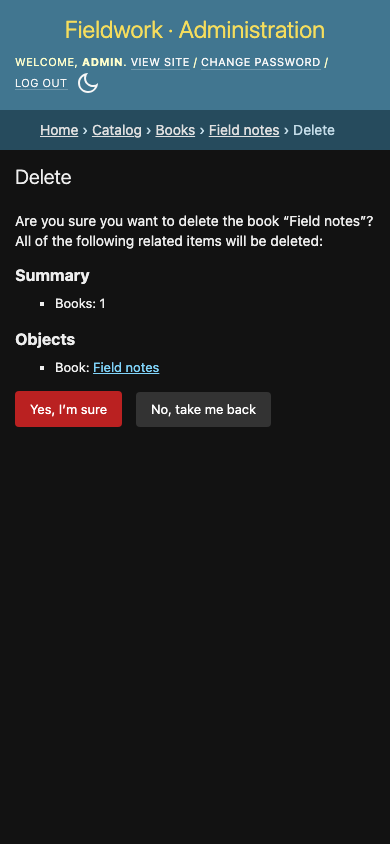](../evidence/style-parity/6.1.1/390-dark-delete-htmx.png) |
